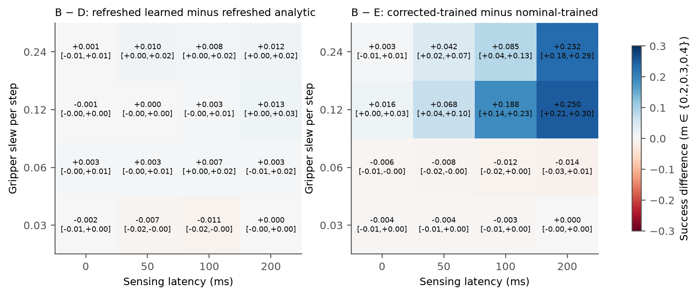
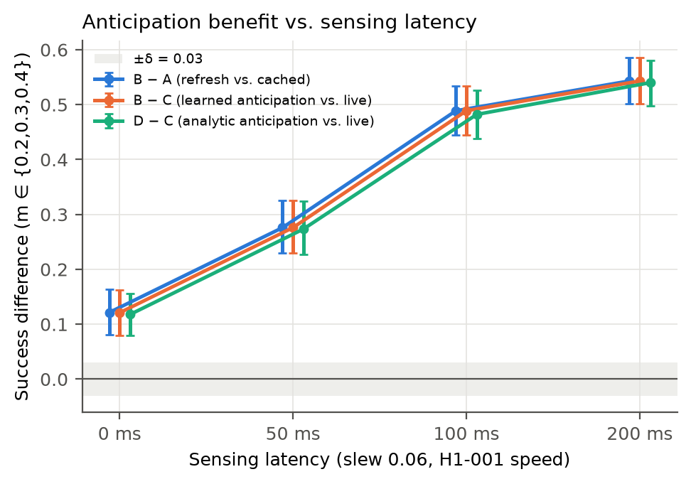

# H1-002 results — Is learned tactile forecasting necessary?

*For Praneeth, Aarav, and Alan. Simulation only. The full report, with every
number and its source file, is [`experiments/H1-002.md`](experiments/H1-002.md).
The analysis plan and decision rules were registered before running
([`experiments/H1-002_PROTOCOL.md`](experiments/H1-002_PROTOCOL.md)).*

## The question

H1-001 showed that refreshing a learned tactile forecast at the moment an
action is corrected prevents grasp drops that live feedback alone does not.
Three explanations were possible:

* **A.** The learned predictor captures something a simple method cannot.
* **B.** Any simple, action-aware anticipation would do the same.
* **C.** The effect exists only because the gripper is slow or feedback is late.

## What we ran

* **The same grasp-and-lift task and the same safety controller as H1-001,
  with six forecast conditions:**
  * cached learned (A)
  * refreshed learned (B)
  * live feedback only (C)
  * a **two-parameter analytic model** (D): grip command → slew-limited grip →
    calibrated force. It uses no learning and does not know object mass or
    friction.
  * a learned model trained **only on uncorrected actions** (E)
  * a non-deployable oracle (O)
* **4 gripper speeds**, from a full stroke in 1.67 s down to 0.21 s.
* **4 tactile sensing delays**: 0, 50, 100, and 200 ms.
* **5 grip-reduction sizes**, plus a lift-speed-increase direction.
* 150 matched trials per setting, 5 predictor seeds, **226,800 episodes**.
* We first confirmed that the new code reproduces 320/320 saved H1-001
  episodes exactly.

## What we found

1. **The simple analytic model matches the learned predictor everywhere.**
   Success difference, learned minus analytic (for reductions of 20–40% of
   the grip range):
   * +0.3 points at the H1-001 setting, 95% CI [−0.2, +1.0];
   * +0.3 points pooled over all 16 speed × latency settings, CI [−0.0, +0.6].

   No single setting differed by more than 1.3 points, and both matched the
   oracle. On the H1-001 correction trials, the analytic model's force
   forecasts are actually *more* accurate (0.099 vs. 0.113 N). → **Explanation
   B is supported. A learned-forecasting contribution is not established.**

2. **Anticipating the correction still matters a lot, but not for the reason
   we thought.**
   * It helps with the fastest gripper and no sensing delay (+9 points), so
     this is not a slow-gripper artifact. **Explanation C is not supported as
     registered.**
   * The benefit is *smallest* for the slowest gripper (+2 points): a slow
     gripper also slows down the harmful force drop, so live feedback catches it.
   * Sensing delay is the big amplifier: at 200 ms delay, anticipation adds
     +54 points (live-only 13% vs. anticipating ~89% success at the largest
     reduction).
   * The real driver is a **correction that changes contact faster than
     feedback can react**.

3. **Training on corrected actions: it depends.**
   * At the H1-001 speed, the nominal-trained model does as well in closed
     loop, even though its forecasts for big corrections are worse.
   * With fast grippers and delays, it fails badly (e.g. 42% vs. 93% success).
   * The registered verdict is **inconclusive**.
   * Its forecast gap overall (0.034 N) is below our 0.05 N threshold, but it
     reaches 0.39 N for large grip reductions.

4. **Forecast accuracy ≠ control benefit.**
   * The less accurate nominal-trained model sometimes beats the oracle
     (95% vs. 89%), because pessimistic forecasts make this controller grip
     harder.
   * Stale forecasts never hurt relative to having no forecast. They are inert.

5. **Lift-speed corrections caused no failures at all**, so there was nothing
   to anticipate.

## What this means for H1

| | After H1-001 | After H1-002 |
|---|---|---|
| **H1-A** (mismatch after a correction) | preliminary support | **unchanged.** The mismatch exists for any action-conditioned forecaster, learned or analytic. |
| **H1-B** (mismatch can cost success) | preliminary support, narrow (significant at m ≥ 0.25 after the erratum) | **broader in scope, but now explained by simple anticipation.** Refreshing helps across every speed and latency for grip reductions ≥ 0.2, most strongly with sensing delay. A two-parameter physical model gets all of the benefit. |
| Learned tactile forecasting as a contribution | untested | **not established** in this task |

The original H1 wording stands. What H1-002 removes is the implied *need* for
learned tactile prediction in this setting.

## Recommendation

**Do not build a new learned forecasting method on the basis of this task.**
The simulated contact is simple enough that physics plus calibration does as
well. The most informative next step is to **make the plant harder in ways an
analytic model cannot capture**, then re-run the same learned-vs-analytic test:

* compliant or deformable objects;
* varied geometry;
* friction changing mid-episode;
* a realistic tactile array with filtering and drift.

Equivalently, go to **H2 with a policy that actually relies on its forecasts**:
so far stale forecasts were harmless, so the failure H2 targets has not yet
been seen.

## Caveats

* Simulation only.
* The idealized contact signal is a net MuJoCo force.
* One task, one object shape, one controller design.
* At the slowest speed, only one correction time was possible.
* Nothing here applies to the SO-101 without new evidence.
