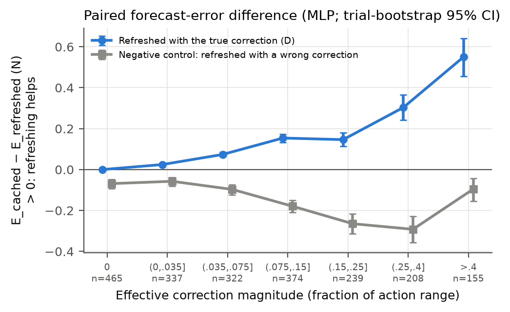
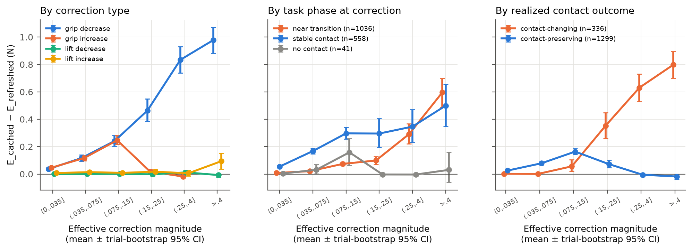
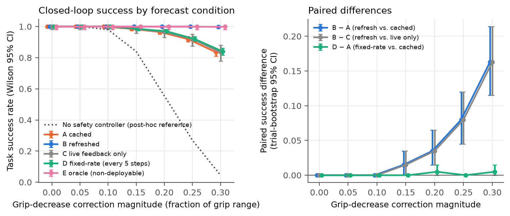

# H1 — Preliminary results (simulation)

*For Praneeth, Aarav, and Alan. Written so it can be read without the code.
The full report, with every number and its source file, is
[`docs/experiments/H1-001.md`](experiments/H1-001.md). All results come from one
simplified MuJoCo task. None of them are from a real robot.*

**H1 (original wording, unchanged):** *After sufficiently large action
corrections, forecasts conditioned on the original action become less accurate
than refreshed forecasts, and this mismatch can reduce task success.*

## 1. Executive summary

**What we tested.** In a simulated two-finger grasp-and-lift task, a small
learned model predicts the next 0.5 s of pad contact forces from recent
contact history and a proposed action chunk. We changed the action chunk after
the forecast was made and asked two questions:

* **H1-A:** Is the old ("cached") forecast less accurate than a "refreshed"
  forecast for the corrected chunk? We ran 2100 paired trials with 5
  independently trained predictors.
* **H1-B:** Does using the stale forecast cost task success, compared with
  refreshing it? We tested a grasp-safety controller that also has live
  contact feedback, on 1400 trials and 23,800 episodes.

**What we saw.**

* **H1-A.** Yes. For corrections ≥ 15% of the action range, refreshing cut
  forecast error from 0.49 N to 0.18 N (paired difference +0.30 N, 95% CI
  [0.27, 0.34], in all 5 seeds). The effect follows how much the correction
  *actually* changed contact (r = 0.91), not the commanded size of the
  correction.
  * There is essentially no effect for lift corrections, because the predictor
    barely responds to them.
  * Refreshing is neutral to very slightly harmful when the correction does not
    change contact.
* **H1-B.** Yes, in a narrow sense. When an upstream grip reduction of 20–30%
  hit a slow gripper during lifting, refreshing the forecast at the moment of
  the correction kept success at ~100%. The stale-forecast controller dropped
  to 83.5% (m = 0.3; difference +16 points, CI [+12, +21]).
  * Live feedback alone did exactly as badly as the stale forecast.
  * Refreshing every 5 steps on a fixed schedule did no better.
  * The stale forecast never did *worse* than having no forecast. It simply
    failed to anticipate.

**Verdict.**

| | Verdict |
|---|---|
| **H1-A** | **Preliminary support** under tested conditions |
| **H1-B** | **Preliminary support, narrow.** One scenario, deliberately chosen so that staleness could matter. A simpler, non-learned alternative was not ruled out. |
| H1 as a whole | Supported in simulation for one task, with important qualifications (§4, §6). **Not validated for real tactile robotics.** |

## 2. Experimental setup

**Environment** (MuJoCo; `src/contact_learning/environments/gripper_lift.py`).

* A gripper on a vertical slide grasps and lifts a 4 cm box. Mass
  (0.05–0.20 kg) and friction (μ 0.6–1.0) are randomized per episode.
* Control is at 20 Hz with two actions:
  * a **grip command**, passed through a slew limit so the gripper takes
    ~0.85 s to fully close (like a slow hobby servo);
  * a **lift speed**.
* The **contact signal** has four channels: the normal and the tangential force
  on each pad, in newtons. It is MuJoCo's net contact force plus small noise,
  **not a model of a tactile sensor**.
* We verified that the signal behaves physically before using it:
  * normal force follows the expected grip-force relation within 3 mN;
  * friction carries the weight of a held box;
  * hold or drop matches Coulomb friction in 79/80 cases.

**Predictors** (trained on 2000 randomized episodes per seed, 5 seeds):

* **MLP** (main model): sees 4 steps of history and the 10 future actions;
  predicts 10 future contact frames.
* **Ridge regression:** linear, action-conditioned.
* **History-only MLP:** cannot see future actions, so cached and refreshed are
  identical by design (a control).
* **Persistence:** "contact stays as it is now."

On held-out episodes, the RMSE was:

| Model | Held-out RMSE |
|---|---|
| MLP | **0.144 N** |
| History-only MLP | 0.235 N |
| Ridge | 0.286 N |
| Persistence | 0.522 N |

So the main model is clearly better than trivial baselines, and it does use the
actions.

**H1-A procedure.**

1. Run the nominal plan to a correction time.
2. Take the next 10-step action chunk.
3. Apply a correction: grip ±, or lift ±, at 0–50% of the action range.
4. Predict once with the original chunk (cached) and once with the corrected
   chunk (refreshed), from the *same* history.
5. Execute the corrected chunk.
6. Score both forecasts against what happened.

**H1-B procedure.**

* An upstream module reduces the grip command by m ∈ {0, …, 0.3} for the rest
  of the episode.
* A downstream safety controller tries to keep pad force ≥ 1.7 N. It uses live
  measured force every step, in every condition, plus a forecast term that
  differs by condition:
  * **A cached:** the forecast made before the correction
  * **B refreshed:** a new forecast at the correction
  * **C live only:** no forecast term
  * **D fixed-rate:** refreshed every 5 steps
  * **E oracle:** the true future, which is not deployable
* Success means the box is lifted ≥ 5 cm and still held at 3 s.
* Everything else is identical across conditions: seeds, plans, controller
  gains, and predictors.

The analysis plans and pass/fail criteria were written down **before** the full
runs ([`experimental_protocol.md`](experimental_protocol.md)).

## 3. Key results

### H1-A — forecast mismatch (MLP, 2100 trials, averaged over 5 seeds; 95% bootstrap CIs)

| Effective correction (fraction of range) | n | Cached error (N) | Refreshed error (N) | Difference D (N) |
|---|---|---|---|---|
| 0 | 465 | 0.110 | 0.110 | 0 exactly |
| ≤ 0.035 | 337 | 0.161 | 0.136 | +0.025 [0.021, 0.029] |
| 0.035–0.075 | 322 | 0.203 | 0.129 | +0.074 [0.063, 0.084] |
| 0.075–0.15 | 374 | 0.297 | 0.143 | +0.154 [0.134, 0.174] |
| 0.15–0.25 | 239 | 0.368 | 0.222 | +0.146 [0.114, 0.181] |
| 0.25–0.4 | 208 | 0.474 | 0.171 | +0.304 [0.242, 0.366] |
| > 0.4 | 155 | 0.681 | 0.131 | +0.550 [0.455, 0.642] |

**By correction type**, the picture is very uneven:

| Correction type | D (N) |
|---|---|
| grip decrease | **+0.45** |
| grip increase | **+0.13** |
| lift decrease | +0.00 |
| lift increase | +0.02 |

Lift increases did change the real contact (by ~0.19 N RMS; lift decreases by
~0.07 N), but the predictor hardly responds to them, so refreshing gains little.

**By outcome:**

| Outcome | D (N) |
|---|---|
| Corrections that changed contact state (n = 336) | **+0.52** |
| Corrections that only changed force levels (n = 1299) | **+0.08** |

**Negative control.** Refreshing with the *wrong* correction made forecasts
worse (−0.23 N), as it should. This rules out a pipeline artifact.

### H1-B — closed-loop success

| Grip-decrease magnitude | A cached | B refreshed | C live only | D fixed-rate | E oracle |
|---|---|---|---|---|---|
| 0 – 0.10 | 100% | 100% | 100% | 100% | 100% |
| 0.15 | 98.5% | 100% | 98.5% | 98.5% | 100% |
| 0.20 | 96.5% | 100% | 96.5% | 97.0% | 100% |
| 0.25 | 92.0% | 100% | 92.0% | 92.0% | 100% |
| 0.30 | 83.5% | 99.8% | 83.5% | 84.0% | 100% |

* **Statistics.** B beats A with Holm-corrected McNemar p < 0.05 at m ≥ 0.2,
  in all 5 predictor seeds. Every discordant trial favours B, and none favours
  A. At m = 0.15 the difference is only 3 trials (not significant).
* **The forecast does change the actions.** The refreshed condition commands
  substantially more grip after the correction. At m = 0.3, the minimum pad
  force after the correction was 1.87 N under B vs. 0.50 N under A, C, and D.
* **Cost.** B made 4.5 forecasts per episode, vs. 3.5 for A and 7.0 for D. Each
  MLP forecast takes ~0.07 ms on a laptop CPU, which is negligible against the
  50 ms control period.
* **Post-hoc reference** (not part of the registered comparison). With *no*
  safety controller, these corrections drop success to 84% at m = 0.15 and to
  4.5% at m = 0.3. The corrections genuinely threaten the grasp.

## 4. Does the evidence support H1?

**H1-A — Preliminary support.**

* **Empirical observation.** Cached forecasts are less accurate than refreshed
  ones whenever the correction changes the realized contact in a direction the
  predictor models. The effect is detectable even at 2–3.5% corrections, so
  "sufficiently large" is small here.
* **Statistical evidence.** Every non-zero magnitude bin is significant after
  Holm correction. The large-correction effect is consistent across 5 seeds,
  and the negative controls behave correctly.
* **Interpretation.** This is partly expected by construction: an accurate,
  action-sensitive model must disagree with itself when the action changes the
  outcome. The informative results are about where the effect appears:
  * it scales with realized contact change, not commanded magnitude;
  * it vanishes for action dimensions the predictor is insensitive to;
  * it is slightly negative when nothing really changed.

**H1-B — Preliminary support (narrow).**

* **Empirical observation.** In this scenario (slow gripper, grip reduction
  during lift), a stale forecast fails to prevent drops that an
  event-triggered refreshed forecast prevents. The refreshed predictor matched
  the oracle.
* **Statistical evidence.** The differences are significant at m ≥ 0.2 in all
  seeds. With 200 trials per magnitude, smaller effects (m ≤ 0.15) are
  undetectable.
* **Interpretation.** The benefit comes from **acting on the corrected action
  before the contact change is measurable**. Live feedback reacts only after
  force has fallen, and the slow gripper cannot recover in time. A 5-step
  refresh schedule is already too late.
* **Untested.**
  * Whether a learned *tactile* forecast is needed at all, rather than any
    action-aware feed-forward. A one-line rule using the known grip-to-force
    gain might do the same.
  * Whether the result survives realistic sensing latency, a faster gripper,
    other tasks, or real hardware.

**Overall.** In simulation, H1's mechanism exists and can matter for control
under specific conditions: actuation slower than the contact change, and a
correction that weakens contact. In this task, though, a stale forecast was
*inert*, not *misleading*. It did not drive the controller toward worse
actions than having no forecast.

## 5. What surprised us?

1. **Live feedback did not rescue the stale forecast.** We expected
   zero-latency live force feedback to make forecasts redundant. It did not,
   because the bottleneck was gripper speed, not sensing.
2. **Fixed-rate refreshing (every 5 steps = 250 ms) gave essentially no
   benefit.** All of the value was in refreshing *at the moment of the
   correction*. Timing matters more than refresh frequency.
3. **The learned forecast was as good as the oracle in H1-B**, even though its
   H1-A error is far from zero. For this controller, the forecast only needed
   the direction and rough size of the force drop.
4. **The predictor almost ignores lift corrections.** Lift increases change
   the realized contact by ~0.19 N, but the forecast shifts by only 0.02–0.08 N. A
   refreshed forecast is only as good as the predictor's action sensitivity.
   This is a predictor-quality limit that a training-loss number would not
   reveal.
5. **Commanded correction size is a poor proxy.** Large grip-increase commands
   issued before contact changed nothing within the horizon, because the slow
   fingers had not reached the object. The predictor still shifted its
   forecast, so refreshing slightly *hurt*.
6. **Environment bugs dominated our first predictor results.** A stiff servo
   pressing pads onto a dropped box created ~70 N phantom contacts that made up
   94% of forecast error. They were caught and fixed before any H1 trial, but
   this shows how easily simulated "tactile" data can mislead.

## 6. Limitations

* **Simulation and sensing.**
  * The contact signal is an exact net force, with no sensor latency, spatial
    distribution, hysteresis, or calibration error.
  * Friction and softness are uncalibrated.
  * One object shape and a narrow parameter range.
  * Nothing here transfers to an SO-101 with a real tactile sensor without new
    evidence.
* **Task.** The task is close to quasi-static, with a nearly linear
  grip → force map. That is easy to learn, and real contact is often not like
  this.
* **Predictor.** One architecture and one data distribution. Its training data
  already contained random corrections, which favours good refreshed forecasts.
  A predictor trained only on nominal demonstrations (plan §5.1) might do
  worse.
* **Controller.**
  * The H1-B safety layer was designed by us and is one-sided (it only adds
    grip).
  * It effectively undoes the upstream correction, which is artificial.
  * The scenario was chosen because staleness *could* matter there, so it is
    not a representative sample of situations.
* **Statistics.** H1-B failures are rare at small magnitudes, so the power
  there is low. Test trials are shared across predictor seeds. All conditions
  ran on one machine and one software stack.
* **Not tested.**
  * sensing latency
  * actuator speed as a factor
  * error-triggered refreshing (named in the plan)
  * analytic feed-forward
  * external disturbances (that is H2)
  * other tasks
  * any physical robot

## 7. Recommended H1 refinement (proposal; the original H1 above is unchanged)

> **Proposed H1′ (for discussion).** When an action correction changes the
> realized contact by more than the predictor's error, *in an action dimension
> to which the predictor is sensitive*, a forecast conditioned on the original
> action is less accurate than one conditioned on the corrected action. When
> actuation is slower than the resulting contact change, an **event-triggered**
> refresh at the correction prevents failures that live contact feedback and
> fixed-rate refreshing do not.

What changes from H1:

* "sufficiently large" becomes *realized* contact change relative to predictor
  error, not commanded magnitude;
* the claim is conditioned on predictor sensitivity;
* "can reduce task success" is narrowed to the actuation-speed regime where we
  observed it;
* the comparison is against live feedback and fixed-rate refresh, not only
  against the stale forecast.

## 8. Next experiment (single most informative)

**H1-002: Is it the forecast, or just reacting to the correction?
A feed-forward ablation crossed with actuator speed and sensing latency.**

Keep the H1-B scenario and add two conditions:

* **F, analytic feed-forward:** at the correction, compensate using the known
  grip → force gain. This uses no learned forecast and no tactile history.
* **G, refreshed forecast from a predictor trained only on nominal,
  uncorrected actions.** This tests the plan §5.1 distribution-shift concern.

Cross these with:

* gripper slew rate (slow / medium / fast);
* live-feedback sensing latency (0 / 50 / 100 ms).

**Why this is the most informative next step.** It separates the three
explanations for the H1-B result that we currently cannot tell apart:

1. a *learned tactile forecast* is needed;
2. any action-aware anticipation suffices;
3. the effect exists only because the gripper is slow.

Case 2 would mean the H1 mechanism is real but not a contribution in itself.
Case 3 would bound where the problem matters for SO-101-class hardware.
Register the criteria first. The infrastructure already supports this (new
conditions in `evaluation/h1b.py`; slew and latency in `EnvConfig`).

## 9. Implications for H2 and H3

* **H2** (selective intervention when forecasts and live touch disagree). Our
  results neither support nor undermine H2. They do show that **H2 needs a
  controller that actually relies on forecasts against measurements**. In our
  H1-B controller, a stale forecast was harmless because live feedback still
  acted. The "outdated forecast overrides informative live feedback" failure
  that H2 targets cannot occur in this controller by design. An H2 test needs a
  policy where the forecast pathway can dominate, such as a learned policy
  conditioned on the forecast. Building that first is the right order.
* **H3** (selective update rule at a matched compute budget). In this setting,
  a forecast costs ~0.07 ms, so always refreshing is essentially free. A
  "selective" rule has little budget to save. H3 becomes meaningful only with
  an expensive forecaster (for example, a large world-action model or a
  diffusion policy with a tactile head), where refresh latency competes with
  the control period. Note also that *event-triggered* refreshing already beat
  fixed-rate refreshing here. A selective rule must beat that simple baseline,
  not only periodic refreshing.
* **Recommendation.** Investigate H1 further (H1-002) before starting H2. If
  analytic feed-forward matches the learned forecast (F ≈ B), reconsider
  whether "forecast refreshing" is the right framing for the contribution. In
  that case the plan's §5.1 alternative (forecasting on policy-generated
  actions) becomes more attractive. If B > F, especially with sensing latency
  and a nominal-trained predictor, proceed to an H2 setup with a
  forecast-dependent policy.
