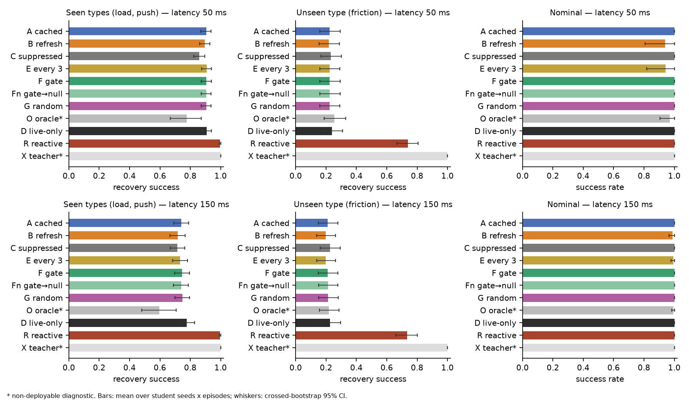
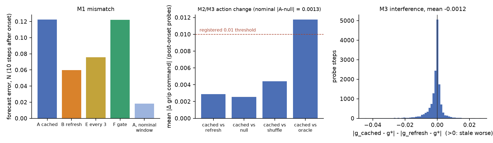

# H2-001A results — Do stale tactile forecasts interfere with recovery?

*For Praneeth, Aarav, and Alan. Simulation only, on a laptop CPU. The full
report, with every number and its source, is
[`experiments/H2-001A.md`](experiments/H2-001A.md). The analysis and decision
rules were registered before running
([`experiments/H2-001A_PROTOCOL.md`](experiments/H2-001A_PROTOCOL.md)).*

## The question

H2 asks whether an **outdated predicted-contact signal can make a learned
controller recover worse** from an unexpected contact change, even when live
touch already shows the change. We tested the chain of three mechanisms
needed for that to be true:

1. **Mismatch:** the forecast is wrong after the disturbance.
2. **Interference:** that wrong forecast changes the action for the worse.
3. **Degradation:** those actions cause more failed recoveries.

## What we ran

**Task.** A gripper lifts and holds a *fragile* object, which slips if
gripped too weakly and is crushed if gripped too hard.

**Disturbances,** all through simulator physics, never by editing the sensor:

* an added downward load;
* a sideways push;
* a gradual friction drop (never seen in training).

Each comes in recoverable and unrecoverable strengths.

**Controllers:**

* **The learned controller:** a small network trained to imitate a privileged
  teacher. It sees live touch (50 ms or 150 ms delayed) and a learned 1-second
  contact forecast.
* **A twin trained without the forecast.**
* **A simple hand-written grip rule.**

**Same network, seven ways of handling its forecast:**

| | Handling |
|---|---|
| A | keep it cached (deployed default) |
| B | refresh every step |
| C | switch it off |
| E | refresh every 3 steps |
| F | refresh when forecast and touch disagree |
| G | refresh at random, the same number of times as F |
| O | an oracle (perfect forecast) |

**Pairing.** Every condition is branched from the *identical* simulator state
at the moment of the disturbance.

**Scale.** 5 independently trained seeds × 770 held-out episodes × 2 sensing
delays: 7,700 paired episodes per condition, plus 77,000 paired "same state,
different forecast" action probes. Everything ran in about 50 minutes on this
Mac.

## What we found

1. **The forecast does go stale, but staleness does not hurt.**
   * After a disturbance, the cached forecast's error is about 7× its normal
     level.
   * Holding everything else fixed and swapping in a fresh forecast changes
     the grip command by only 0.003 (on a 0–1 scale). The fresh-forecast
     action is no closer to the teacher's.
   * Refreshing changes recovery by **−0.9 points [−2.9, +1.0]**, within our
     ±3-point equivalence margin.
2. **The learned controller barely uses its forecast. Removing it still costs
   a little.**
   * Switching the forecast off lowers recovery by **4.5 points
     [2.4, 6.9]**.
   * So the forecast is mildly *helpful* even when stale, never harmful.
   * The twin trained without any forecast does just as well (and better with
     a 150 ms delay: +3.5 points).
3. **Selective "refresh when it disagrees" gating did nothing.**
   * Equal to the cached forecast, and to random refreshing at the same
     budget.
   * The trigger rarely fired after real disturbances (6% of episodes at
     50 ms). It fired more often during normal lift-offs.
4. **A simple grip rule beat every learned variant.**
   * The rule: squeeze to 1.4× the expected weight, more if measured shear
     rises.
   * It recovered 99.7% vs. 90.5% of seen disturbances, and 74% vs. 22% of the
     unseen friction drop.
   * The price is about 30% more squeeze force.
5. **The one harmful forecast effect was the *opposite* of H2.**
   * In one of five seeds, refreshing *more often* than training had used made
     the policy over-squeeze: 30% of normal episodes crushed.
   * The oracle forecast also *lowered* recovery (−13 points).
   * Both are "too fresh / too unusual" inputs, not stale ones.

## Verdict

| Mechanism | Result |
|---|---|
| Forecast mismatch after disturbance | **Established** |
| Policy meaningfully depends on the forecast | **Weak** (50 ms) / **absent** (150 ms) |
| Stale forecast → worse action | **Not established** (slightly the reverse) |
| → lower recovery | **Not established** (equivalent within ±3 points) |
| Selective gating helps | **No** (no harm either) |
| Simple reactive control as good? | **Better** |

**Registered verdict for H2 in this setting: contradicted.**

## What this means

For a learned controller that has the forecast as *one optional input*,
stale predictions are harmless. The policy learns to lean on live touch, so
there is nothing for a selective-update rule to fix.

This does **not** test the architecture H2 was written about. In a TacPAC-style
world-action model, actions are generated *jointly with* predicted touch, so
the policy cannot simply ignore it. That is still the right test, and the
ManiFeel GPU work (H2-001) remains the way to run it.

## Recommendation

* **Revise H2:** make "the policy's actions depend on the forecast" a
  measured precondition, not an assumption.
* **Resume ManiFeel when GPU access returns,** and measure that dependence
  first.
* **Cheap local next step (H2-001B):** the only interference we saw came from
  refreshing on a different schedule than training used. Test that directly
  (training vs. test refresh schedules). It bears on H3: an update rule must
  not push a learned policy off the forecast ages it was trained on.

## Caveats

* Simulation only.
* The "touch" signal is an idealised force proxy.
* One small policy class, one task.
* Some task settings were tuned on development data so the learned policies
  work at all. They are disclosed in the protocol.
* The off-schedule-refresh harm comes mainly from one seed.
